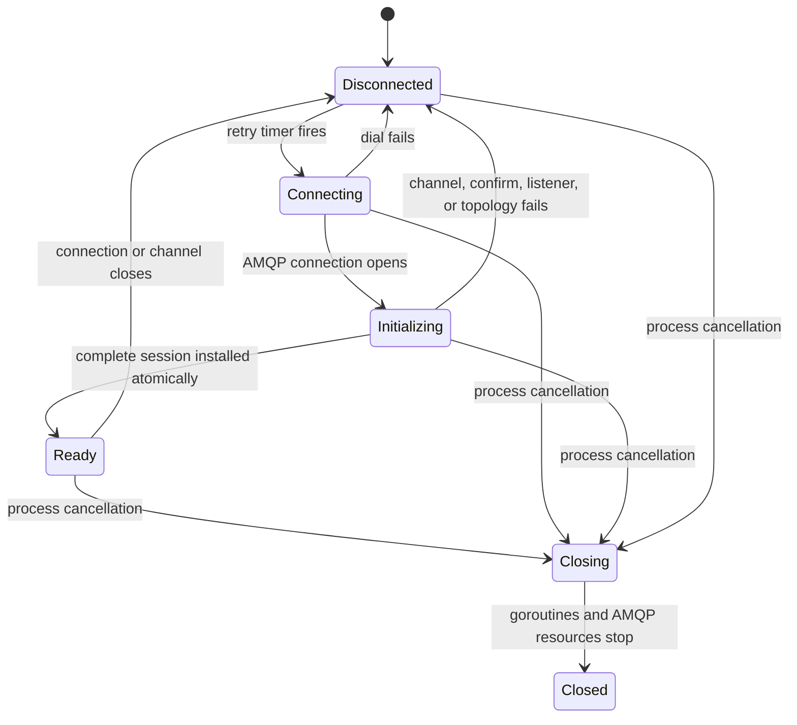

# Phase 0: Build an Honest Reliability Foundation

Phase 0 turns EventPulse from a working RabbitMQ demonstration into a component whose behavior is deliberate when RabbitMQ, the network, or the application fails.

The goal is not to claim that no event can ever be lost. The goal is to know what the application guarantees, expose the cases it cannot know, and prove that its connection and publisher recover together.

## What we are building

By the end of this phase, EventPulse should satisfy this contract:

- Configuration is validated before the application starts doing work.
- The AMQP connection, publisher channel, confirm mode, return listener, and topology are treated as one recoverable session.
- A new session is not advertised as ready until all of those pieces exist.
- If either the connection or channel closes unexpectedly, the entire session is invalidated and rebuilt with capped exponential backoff and jitter.
- A publish always has a deadline and a stable message ID.
- A publish is not called successful until RabbitMQ confirms it.
- Unroutable messages are observable instead of silently disappearing.
- When the broker's answer is unknowable, the caller receives an explicitly uncertain result.
- Shutdown stops new work, lets bounded in-flight work finish, closes AMQP resources, and waits for goroutines.
- Unit and integration tests exercise the failure paths, including a broker restart.

The following are deliberately outside Phase 0:

- Consumers, acknowledgements, retries, and dead-letter queues
- PostgreSQL and analytics aggregation
- HTTP ingestion and dashboards
- High-throughput asynchronous confirm batching
- RabbitMQ clustering and multi-node failover
- A promise to retain events while EventPulse itself is offline

Those features depend on this foundation. Adding them first would make failures harder to reason about.

## Why the current implementation needs this phase

The current connection wrapper replaces `Connection.conn` after a failure. The publisher, however, stores the channel it received during startup:

```text
startup:   connection A -> channel A -> publisher
failure:   connection A closes, therefore channel A closes
recovery:  connection B is created
problem:   publisher still points to channel A
```

RabbitMQ connections and channels have separate lifecycles. Reconnecting a TCP connection does not repair channels created from the previous connection. RabbitMQ's reliability guide explicitly says that channels on a failed connection are closed and must be reopened.

There are four related but different statements:

1. **Connected:** a TCP/AMQP connection exists.
2. **Ready:** the publisher channel exists, confirm mode is enabled, listeners are registered, and topology is declared.
3. **Confirmed:** RabbitMQ has accepted responsibility for a particular publication.
4. **Routed:** the publication matched at least one queue.

They are not interchangeable. In particular, RabbitMQ can positively confirm an unroutable message. With `mandatory=false`, that message can be discarded silently.

## The mental model: a recoverable session

Treat all connection-bound resources as a single generation called a **session**.



A session contains at least:

```go
type session struct {
	connection *amqp.Connection
	publisher  *amqp.Channel
	returns    <-chan amqp.Return
	connClosed <-chan *amqp.Error
	chanClosed <-chan *amqp.Error
	generation uint64
}
```

The generation is useful in logs and tests. More importantly, invalidation must compare session identity before clearing shared state. A late notification from session 3 must never mark session 4 as unavailable.

For Phase 0, rebuild the whole session when either the connection or publisher channel fails. Reopening only a channel on a still-healthy connection is an optimization that can come later. Full-session recovery has fewer states and is easier to verify.

## Design decisions to make explicit

### 1. Do not buffer indefinitely while disconnected

`Publish` should return a recognizable `ErrNotReady` while there is no ready session. An unbounded in-memory retry queue appears convenient but creates several problems:

- Memory usage grows without limit during a long outage.
- Events disappear if the process crashes.
- Old events can overwhelm the broker immediately after recovery.
- Callers cannot apply backpressure or report degraded service.

Later, the HTTP ingestion service can return `503 Service Unavailable` and let clients retry with the same event ID. If offline durability becomes a requirement, introduce a real durable outbox rather than hiding a queue inside the publisher.

### 2. Use stable IDs across retries

The tracking event already has an ID. Use that same value as AMQP `MessageId`; do not generate a second ID in the publisher.

If a connection fails while a confirmation is in flight, the message may have been accepted even though the publisher did not receive the confirmation. A retry is therefore allowed to create a duplicate. Reusing the same ID makes later idempotent consumption possible.

### 3. Make uncertainty part of the API

Define errors that communicate what the caller knows:

```go
var (
	ErrNotReady        = errors.New("broker is not ready")
	ErrPublishNacked   = errors.New("publish was rejected by the broker")
	ErrPublishReturned = errors.New("publish was unroutable")
	ErrPublishUncertain = errors.New("publish outcome is uncertain")
)
```

The exact names are less important than the distinction:

| Result | What is known | Reasonable caller behavior |
|---|---|---|
| Validation or marshal error | The message was not sent | Fix or reject the event; do not retry unchanged input |
| `ErrNotReady` before sending | No ready session was available | Retry later with the same event ID |
| Broker nack | RabbitMQ rejected the publication | Retry according to policy and alert if repeated |
| Returned publication | No queue accepted the routing key | Treat as a topology/configuration defect |
| Timeout or disconnect after sending | RabbitMQ may or may not have accepted it | Retry only with the same ID and expect deduplication later |
| Confirmed | RabbitMQ accepted responsibility | Continue; this is not proof that a future consumer processed it |

### 4. Keep readiness stricter than liveness

- **Liveness** answers: "Is the process running and able to make progress?"
- **Readiness** answers: "Should new publish requests be sent here?"

During reconnection, the process can remain live while readiness is false. Readiness becomes true only after topology and publisher setup completes.

## Implementation plan

Implement the phase as small reviewable changes. Each step should leave the project buildable.

### Step 1: Centralize and validate configuration

Add `internal/config/config.go` and move environment parsing out of `main`.

Suggested configuration:

```go
type Config struct {
	RabbitMQURL       string
	LogLevel          slog.Level
	StartupTimeout    time.Duration
	PublishTimeout    time.Duration
	ShutdownTimeout   time.Duration
	ReconnectBase     time.Duration
	ReconnectMax      time.Duration
	RabbitMQHeartbeat time.Duration
	GeneratorRate     int
}
```

Validate at least:

- `RABBITMQ_URL` is present and parses as an AMQP URI.
- All timeouts are positive.
- Base backoff is no greater than maximum backoff.
- Generator rate is positive and does not produce a zero ticker interval.
- Log level is one of the supported values instead of silently falling back after a typo.

Use development defaults for non-secret settings. Do not provide a production-looking default credential.

Never log the raw AMQP URL. It can contain a username and password. Log a redacted address or stable broker label instead.

Use `amqp.DialConfig` so heartbeat, connection name, and other connection behavior are explicit rather than accidental defaults.

What this teaches:

- Configuration is part of the application's public contract.
- Validation should fail close to the source of an error.
- Operational metadata and secrets require different logging rules.

### Step 2: Put connection ownership in one lifecycle component

Replace the split ownership where `Connection` reconnects but `Publisher` retains an old channel. A `broker.Client` or `broker.SessionManager` should own:

- The connection
- The publisher channel
- Confirm mode
- Return, connection-close, channel-close, and blocked notifications
- Topology initialization
- Current readiness and generation
- Reconnect policy
- Shutdown signaling and goroutine tracking

A useful file layout is:

```text
internal/broker/
├── client.go       # state and Run loop
├── session.go      # dial and initialize one generation
├── publisher.go    # publish behavior and result mapping
├── backoff.go      # retry policy
├── errors.go       # public error categories
└── topology.go     # topology model, validation, and declaration
```

Avoid performing network calls while holding the state mutex. Dialing, declaring topology, publishing, and waiting for confirms can block. Build a candidate session privately, then take the mutex briefly to install it.

The core loop should resemble:

```go
func (c *Client) Run(ctx context.Context) error {
	for attempt := 0; ; attempt++ {
		if err := ctx.Err(); err != nil {
			return nil
		}

		s, err := c.openSession(ctx)
		if err != nil {
			if err := c.waitBeforeRetry(ctx, attempt); err != nil {
				return nil
			}
			continue
		}

		c.install(s) // state lock is held only for the pointer/state swap
		attempt = 0

		if err := c.waitForSessionEnd(ctx, s); err != nil {
			c.logger.Warn("broker session ended", "generation", s.generation, "error", err)
		}

		c.invalidate(s) // only invalidates if s is still current
		s.close()
	}
}
```

This is structural pseudocode, not a copy-paste implementation. In the real loop, ensure an immediately failed session does not reset retry backoff forever. Either reset after a stable period or maintain separate consecutive-failure accounting.

`openSession` must be all-or-nothing:

1. Dial the connection.
2. Create the publisher channel.
3. Enable confirm mode.
4. Register return, connection-close, channel-close, and blocked listeners.
5. Declare exchanges, queues, and bindings.
6. Start notification handling.
7. Return the complete candidate session.

If any step fails, close every resource created by earlier steps. Do not publish or set readiness during partial initialization.

What this teaches:

- Resource ownership is more important than adding retries around individual calls.
- A small state machine is safer than scattered booleans.
- Atomic state transitions prevent callers from observing half-built resources.
- Channel-level errors and connection-level errors are different, even when Phase 0 handles both with a full rebuild.

### Step 3: Add context-aware backoff with jitter

Keep exponential backoff, but add jitter and make waiting cancelable.

One suitable policy is **full jitter**:

```text
cap(attempt) = min(maximum, base * 2^attempt)
delay        = random duration from 0 through cap(attempt)
```

Jitter prevents many replicas from reconnecting at exactly the same moments after a shared broker outage. Cap arithmetic carefully so a large attempt count cannot overflow `time.Duration`.

Use a timer selected alongside `ctx.Done()` rather than `time.Sleep`. Inject the random source, or make the delay calculation a pure function, so tests do not actually wait.

Log only one structured event per attempt with fields such as:

```text
event=reconnect_attempt attempt=4 delay=7.2s generation=12
```

Do not emit the credential-bearing connection URL.

What this teaches:

- Retry policies affect the system being recovered, not just the client.
- Cancellation must work while sleeping as well as while processing work.
- Time and randomness should be controlled in tests.

### Step 4: Rebuild publishing around explicit outcomes

Change `Publish` so the caller provides the stable event/message ID:

```go
func (c *Client) Publish(
	ctx context.Context,
	exchange string,
	routingKey string,
	messageID string,
	payload any,
) error
```

For every publication:

- Reject empty exchange, routing key, or message ID where inappropriate.
- Marshal before acquiring the publish lock.
- Take a snapshot of the current ready session.
- Return `ErrNotReady` if no session exists.
- Set `MessageId` to the tracking event ID.
- Use UTC for timestamps.
- Set `ContentType`, `DeliveryMode`, `Type`, and an application/schema identifier deliberately.
- Publish with `mandatory=true` for EventPulse's known processing topology.
- Wait with `DeferredConfirmation.WaitContext(ctx)`, not unbounded `Wait()`.
- Treat a timeout or connection loss after the send as uncertain.

For Phase 0, serializing publications on one publisher channel is acceptable. It makes correctness and return correlation easier to explain. Document that synchronous per-message confirms limit throughput; measure before replacing them with an asynchronous in-flight confirm window.

Register a buffered `NotifyReturn` listener before readiness. A returned message is a serious invariant failure for EventPulse: the exchange exists but no declared queue matched the routing key.

There is an important client-specific caveat: the pinned `amqp091-go` v1.11 library does not promise application-observable ordering between `basic.return` and `basic.ack` notifications delivered on separate Go channels. Therefore:

- Record returned messages by `MessageId`.
- Emit an error log and metric from the return handler.
- Do not claim that a `nil` return from the synchronous `Publish` call is absolute proof of routing unless the correlation design has been tested and documented.
- Consider an alternate exchange and unroutable queue in a later topology phase if every unroutable event must be durably captured.

What this teaches:

- Publishing, broker confirmation, routing, and consumer processing are separate guarantees.
- Distributed failures create unknown outcomes, not only success/failure outcomes.
- Idempotency begins at the producer with stable identity.

### Step 5: Make topology declarative, validated, and repeatable

Keep `SetupTopology`, but make its contract explicit:

- Validate duplicate names and unsupported exchange kinds before contacting RabbitMQ.
- Include every declaration property in configuration; changing durable or queue-type properties for an existing entity can close the channel with `PRECONDITION_FAILED`.
- Declare topology every time a new session is created.
- Treat declaration failure as session initialization failure.
- Do not expose readiness until every binding succeeds.

Topology declaration is usually idempotent only when the entity's properties match. "Declare it again" does not mean "silently change it."

Keep teardown out of normal shutdown. Durable production topology should not be deleted just because one application instance exits. `TeardownTopology` belongs in tests or explicit development tooling.

What this teaches:

- Infrastructure declarations are contracts shared by every producer and consumer.
- Protocol exceptions often close a channel, turning a local-looking error into a lifecycle event.
- Recovery must include application state as well as transport state.

### Step 6: Fix orchestration and graceful shutdown

Move application startup into a `run() error` function. Let `main` handle only final logging and exit status so deferred cleanup inside `run` still executes.

Use `signal.NotifyContext` and one root context. The shutdown order should be:

1. Cancel the root context on `SIGINT` or `SIGTERM`.
2. Stop the generator so no new publishes begin.
3. Allow current publishes to finish only until the shutdown deadline.
4. Mark the broker client not ready.
5. Close the publisher channel and connection once.
6. Stop statistics and notification goroutines.
7. Wait for all owned goroutines.
8. Return from `run`.

Every loop must select on context cancellation, including the statistics ticker. Use `sync.Once` around closure that can be called through more than one path. Avoid closing notification channels owned by the AMQP library.

Never ignore startup or goroutine errors. If the generator exits unexpectedly, report it and cancel sibling work.

What this teaches:

- Graceful shutdown is coordinated ownership, not a collection of `defer Close()` calls.
- `os.Exit` skips deferred functions in the current process.
- A goroutine needs an owner, a stopping condition, and a way to report failure.

### Step 7: Harden the generator at the boundary

The generator is part of the recovery demonstration, so make it deterministic and safe:

- Reject an empty event-type slice.
- Validate rate before calculating ticker duration.
- Give each publish its own timeout derived from the root context.
- Reuse the same event object and ID if a deliberate retry policy is added.
- Distinguish not-ready, uncertain, nack, returned, and permanent encoding errors in statistics.
- Inject a random source for repeatable unit tests.

Phase 0 does not need automatic generator retries. Counting and exposing failed/uncertain events is more honest than silently retrying before an idempotent consumer exists.

## Testing strategy

Reliability code is incomplete until its failure behavior is tested.

### Unit tests

Prefer unit tests for deterministic logic:

| Test area | Important cases |
|---|---|
| Configuration | Missing URL, invalid duration, bad log level, invalid rate, valid defaults |
| Backoff | Starts within base cap, grows, caps, does not overflow, cancellation interrupts wait |
| Lifecycle state | Partial initialization never becomes ready; stale generation cannot invalidate current generation |
| Shutdown | Calling close twice is safe; all loops exit after cancellation |
| Generator | Zero/negative rate, empty event types, deterministic generated fields |
| Topology validation | Duplicate entities, bad exchange type, binding references missing entities |
| Publish classification | Not ready, marshal failure, nack, confirm timeout, connection closure |

Do not create an enormous fake implementation of AMQP just to increase coverage. Keep state/backoff/configuration logic pure, inject a narrow publishing interface into the generator, and test protocol behavior against a real broker.

### Integration tests

Add a separate integration target that uses the Compose RabbitMQ service and is skipped when its required environment is absent.

Minimum scenarios:

1. Start the broker and EventPulse; publish and observe a confirmed event in the expected queue.
2. Stop RabbitMQ while publishing; readiness becomes false and publishes fail within their deadline.
3. Restart RabbitMQ; a new generation declares topology and publishing resumes without restarting EventPulse.
4. Force a channel-level exception; the session is rebuilt.
5. Publish an unmatched routing key; the return listener records it.
6. Cancel while reconnect backoff is active; the process exits promptly.
7. Cancel while waiting for a confirmation; the shutdown deadline is respected.

Run the following quality gates:

```bash
go test ./...
go test -race ./...
go vet ./...
gofmt -d cmd internal
```

The integration suite should also run in CI with a pinned RabbitMQ image, not only on a developer laptop.

### Manual failure demonstration

Keep a short demonstration because it is excellent portfolio evidence:

```bash
make rabbit
make run
docker stop eventpulse-rabbit
docker start eventpulse-rabbit
```

Expected story in the logs:

```text
generation=1 state=ready
generation=1 state=disconnected
attempt=1 state=reconnecting
generation=2 state=initializing
generation=2 state=ready
```

Then show confirmed publishing continuing. The demo should also show error counters during the outage; hiding them would imply a guarantee the system does not provide.

## Mistakes beginners commonly make

| Mistake | Why it fails | Better rule |
|---|---|---|
| Reconnect only the TCP connection | Every old channel is dead too | Rebuild the complete connection-bound session |
| Mark ready immediately after dialing | The channel or topology may still fail | Ready only after all initialization succeeds |
| Create a connection for every publish | Produces latency and broker churn | Prefer long-lived connections and channels |
| Retry in a tight loop | Turns an outage into a reconnect storm | Use capped exponential backoff with jitter |
| Use `time.Sleep` in recovery | Shutdown must wait for sleep to finish | Select a timer alongside context cancellation |
| Assume persistent messages cannot be lost | Persistence depends on durable destinations and confirms | Treat persistence, durability, replication, and confirms as separate settings |
| Assume confirm means routed | Unroutable messages can still be confirmed | Use mandatory returns or an alternate exchange |
| Give a retried event a new ID | One logical event becomes impossible to deduplicate | Preserve identity across every attempt |
| Call every timeout a definite failure | The broker may have accepted the event before the connection failed | Return an uncertain result and design idempotent consumers |
| Hold the lifecycle mutex during network I/O | Slow or stuck I/O can block recovery and shutdown | Build privately; lock briefly to swap state |
| Ignore errors because startup "usually works" | The next line can panic or run partially initialized | Handle every channel, topology, publisher, and goroutine error |
| Log the AMQP URL | URLs commonly contain credentials | Redact user information before logging |
| Close the same signal channel twice | Go panics on double close | Use ownership rules and `sync.Once` |
| Leave background tickers running | Tests hang and shutdown becomes racy | Give every goroutine the root context and wait for it |
| Test only the happy path | Recovery bugs appear only during timing-sensitive failures | Automate restart, timeout, channel-close, and cancellation tests |
| Add async batching immediately | Throughput logic obscures basic correctness | Establish and test semantics before optimizing |

## What it takes to become production ready

Completing Phase 0 makes the publisher foundation credible; it does not make the entire system production ready. Production readiness is a workload-specific operating standard, not a library or checkbox.

### Application reliability

- Define the API contract for not-ready and uncertain publications.
- Add an idempotent consumer before automatically retrying uncertain outcomes.
- Use an outbox if the future ingestion API must accept events while RabbitMQ is unavailable.
- Establish maximum message size, schema-versioning rules, and compatibility tests.
- Handle RabbitMQ connection blocking/resource alarms and expose backpressure.
- Load test the synchronous confirm strategy, then implement a bounded asynchronous confirm window only if measurements justify it.
- Establish retry budgets so applications do not retry forever.

### Broker availability and data safety

- A single Docker RabbitMQ node is a development environment, not high availability.
- For replicated availability, evaluate a three-node RabbitMQ cluster and quorum queues.
- Provide multiple broker endpoints or a suitable load-balancing/discovery strategy.
- Confirm storage, disk, memory watermark, file descriptor, and network requirements under expected load.
- Test node loss, network interruption, disk alarm, rolling upgrade, and recovery procedures.
- Pin supported RabbitMQ and client versions and maintain an upgrade policy.

The repository currently pins `amqp091-go` v1.11, whose documented design leaves reconnection and topology synchronization to the application. Newer client releases have added recovery capabilities. Before production, evaluate upgrading and choose exactly one recovery owner: either the library's supported recovery mechanism or EventPulse's custom session manager. Do not stack two independent recovery loops.

### Security

- Use TLS and verify the broker certificate.
- Use a dedicated RabbitMQ user and virtual host with least-privilege permissions.
- Store credentials in a secret manager rather than a committed `.env` file.
- Remove or change default `guest` credentials outside local development.
- Restrict AMQP, management, metrics, and cluster ports to the networks that need them.
- Redact connection strings and message fields that can contain sensitive data.

### Observability and operations

At minimum expose:

- Current session state and generation
- Reconnect attempts and time spent disconnected
- Confirmed, nacked, returned, uncertain, and not-ready publish totals
- Confirmation latency
- In-flight publication count
- Goroutine count and process/runtime metrics
- RabbitMQ connection, channel, queue depth, message-rate, memory, disk, and alarm metrics

Add alerts for sustained disconnection, returned messages, nacks, growing queue depth, resource alarms, and abnormal confirm latency. RabbitMQ recommends Prometheus-compatible monitoring and Grafana for production monitoring.

Also provide runbooks for:

- Broker unavailable
- Credentials or TLS failure
- Topology precondition failure
- Returned/unroutable messages
- Disk or memory alarm
- Repeated reconnects
- Version upgrade and rollback

### Deployment discipline

- Provide liveness and readiness endpoints with different semantics.
- Stop readiness before terminating an instance.
- Set a shutdown grace period longer than the maximum publish timeout.
- Run unit, integration, race, lint, dependency, and vulnerability checks in CI.
- Build reproducible, minimal container images as a non-root user.
- Publish a compatibility matrix and measurable capacity envelope.
- Practice rollback and disaster recovery rather than only documenting them.

## Suggested commit sequence

Keep Phase 0 understandable in project history:

1. `config: validate runtime and redact broker address`
2. `broker: model connection-bound resources as a session`
3. `broker: recover session with context-aware jittered backoff`
4. `broker: classify confirms, returns, and uncertain publishes`
5. `app: coordinate startup readiness and graceful shutdown`
6. `simulation: validate inputs and preserve event identity`
7. `test: cover lifecycle and RabbitMQ restart recovery`
8. `docs: document publisher guarantees and failure demo`

Do not mix the consumer or database into these commits. A reviewer should be able to follow the reliability story without unrelated features.

## Definition of done

Phase 0 is complete only when all of these are true:

- [ ] No initialization errors are ignored.
- [ ] Raw credential-bearing URLs never appear in logs.
- [ ] Connection and channel failure both invalidate readiness.
- [ ] Channel, confirm mode, listeners, and topology are rebuilt after reconnection.
- [ ] A partial session is never visible to publishers.
- [ ] Backoff is capped, jittered, context-aware, and tested.
- [ ] Every publish has a stable ID and bounded deadline.
- [ ] Confirm, nack, return, not-ready, and uncertain outcomes are observable.
- [ ] The generator and statistics loops stop on cancellation.
- [ ] Closing twice cannot panic.
- [ ] Shutdown waits for owned goroutines within a deadline.
- [ ] Unit tests pass under the race detector.
- [ ] Integration tests prove recovery after a RabbitMQ restart.
- [ ] The README states the actual guarantee without saying "exactly once" or implying high availability.
- [ ] A short failure demo and expected logs are documented.

## What you will have learned

After implementing Phase 0, you should be able to explain:

- Why a RabbitMQ connection and channel must recover together
- Why topology declaration belongs inside session initialization
- How to model readiness with explicit state transitions
- How exponential backoff and jitter protect a recovering dependency
- Why publisher confirms do not prove routing or consumer processing
- Why a network timeout creates an unknown outcome
- How stable IDs prepare a system for idempotent processing
- How context cancellation, mutex scope, and resource ownership affect shutdown
- Why integration and failure tests are essential for distributed systems
- Which claims the local single-node demonstration can and cannot honestly make

That explanation is the real portfolio value. The code shows that EventPulse works; the guide and failure tests show that you understand why it works and where its guarantees end.

## Primary references

- [RabbitMQ reliability guide](https://www.rabbitmq.com/docs/reliability)
- [RabbitMQ publisher guide](https://www.rabbitmq.com/docs/publishers)
- [RabbitMQ consumer acknowledgements and publisher confirms](https://www.rabbitmq.com/docs/confirms)
- [RabbitMQ production deployment guidelines](https://www.rabbitmq.com/docs/production-checklist)
- [RabbitMQ monitoring guide](https://www.rabbitmq.com/docs/monitoring)
- [RabbitMQ quorum queues](https://www.rabbitmq.com/docs/quorum-queues)
- [`amqp091-go` v1.11 documentation](https://github.com/rabbitmq/amqp091-go/tree/v1.11.0)
- [`amqp091-go` releases](https://github.com/rabbitmq/amqp091-go/releases)
